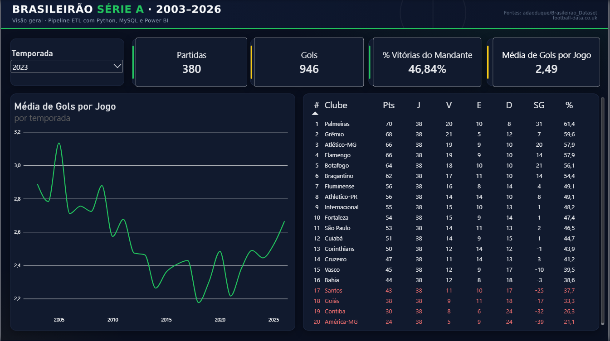

# ⚽ Brasileirão Série A — Pipeline ETL (2003–2026)


Pipeline de dados de ponta a ponta sobre o Campeonato Brasileiro: ingestão de **duas fontes públicas**, limpeza e padronização com **Python/Pandas**, modelagem dimensional e carga em **MySQL**, com dashboard no **Power BI**.

São **9.500+ partidas**, de 2003 até a temporada em andamento.



## 🏗️ Arquitetura

```
GitHub (2003–2024) ──┐                                              ┌─► MySQL (esquema estrela + views) ─► Power BI
                     ├─► Pandas: perfil → limpeza → união → testes ─┤
football-data (2025+)┘          (camada silver)                     └─► output/*.csv (camada gold)
```

| Etapa | O que acontece |
|---|---|
| **Extract** | Download das duas fontes, com cópia bruta imutável em `data/raw/` (camada bronze) |
| **Profiling** | Diagnóstico de nulos, duplicidades e inconsistências antes de qualquer limpeza |
| **Transform** | Schema padronizado, tipos, temporada, correção de datas, resultado recalculado, estádios e clubes unificados |
| **Union** | Junção das fontes com reconciliação nos anos em comum (2012–2024) |
| **Quality checks** | Testes automáticos com `assert`: o pipeline para se algo estiver errado (*fail fast*) |
| **Load** | Esquema estrela no MySQL com PK, FK, CHECK, índices e views analíticas |
| **Visualização** | Dashboard no Power BI com tema e layout próprios |

## 📁 Estrutura

```
├── notebooks/ETL_BRASILEIRAO.ipynb   # pipeline completo (Colab ou local)
├── sql/
│   ├── 01_schema.sql                 # banco, tabelas, PK/FK, CHECKs, índices
│   ├── 02_views.sql                  # vw_partida_clube, vw_classificacao
│   └── 03_load_csv.sql               # carga dos CSVs via MySQL Workbench
├── powerbi/
│   ├── brasileirao.pbix              # dashboard
│   ├── tema_brasileirao.json         # tema escuro customizado
│   └── fundo_visao_geral.png         # plano de fundo da página
└── images/dashboard.png
```

## 🔍 Problemas de qualidade encontrados e tratados

| # | Problema na fonte | Tratamento |
|---|---|---|
| 1 | Temporada 2020 terminou em fev/2021 (pandemia): ano civil ≠ temporada | Regra explícita de temporada + teste do nº de jogos esperado por temporada |
| 2 | **Datas erradas em 3 rodadas** (2008, 2009, 2010): data copiada de outra rodada, com clubes "jogando 2× no mesmo dia" | Detectado por teste de consistência; correção explícita e auditável |
| 3 | Coluna `vencedor` contradiz o placar (Brasiliense 0×1 Vasco, 2005) | Resultado sempre recalculado a partir dos gols |
| 4 | Estádios com espaços extras, marcação `*(PF)` e grafias múltiplas | `strip`, flag `portoes_fechados` e dicionário de-para (159 grafias → 96 estádios) |
| 5 | Nomes de clubes diferentes entre as fontes (`Flamengo RJ`, `Sport Recife`) | Normalização + de-para, com validação que interrompe o pipeline se surgir nome desconhecido |
| 6 | Fonte recente sem UF, estádio, rodada e técnicos | UF herdada do histórico; demais campos `NULL` documentados |
| 7 | Fonte recente com horário do Reino Unido e espaços extras em data/hora | Limpeza + conversão para horário de Brasília, **validada contra o histórico** |

**Reconciliação:** nos 4.939 jogos presentes nas duas fontes (2012–2024), **0 placares divergentes**.

**Validação:** os campeões calculados pela `vw_classificacao` batem com os campeões oficiais de 2003 a 2024.

## 🗄️ Modelo de dados (esquema estrela)

| Tabela | Grão | Destaques |
|---|---|---|
| `fato_partida` | 1 linha por jogo | gols, resultado (M/E/V), rodada, estádio, técnicos, formações, portões fechados |
| `dim_clube` | clube | *role-playing dimension*: ligada 2× na fato (mandante e visitante) |
| `dim_estadio` | estádio | nomes unificados |
| `dim_temporada` | temporada | nº de clubes, rodadas, início/fim, temporada em andamento |
| `dim_estado` | UF | nome e região |
| `vw_partida_clube` | 1 linha por clube por jogo | base para métricas de desempenho |
| `vw_classificacao` | clube × temporada | pontos, V/E/D, saldo, posição (`ROW_NUMBER() OVER`), aproveitamento |

## 📊 Dashboard

- KPIs da temporada: partidas, gols, % de vitórias do mandante e média de gols por jogo
- Evolução da média de gols de 2003 até hoje (independente do filtro de temporada)
- Classificação completa da temporada selecionada, com a **zona de rebaixamento calculada em DAX** (2 rebaixados em 2003, 4 nos demais anos)

## ▶️ Como executar

**Opção A — local:** com o MySQL rodando:

```bash
pip install pandas sqlalchemy pymysql jupyter
```

```bash
cd notebooks && MYSQL_PASSWORD=suasenha jupyter notebook ETL_BRASILEIRAO.ipynb
```

O notebook cria o banco, carrega as tabelas e cria as views.

**Opção B — Google Colab + MySQL Workbench:** rode o notebook no Colab (ele baixa `brasileirao_gold.zip`), extraia os CSVs em `C:/brasileirao_etl/output/` e execute no Workbench: `01_schema.sql` → `03_load_csv.sql` → `02_views.sql`.

**Atualização:** basta repetir o processo. O schema é recriado (*full refresh*), então não há risco de duplicar partidas.

## ⚠️ Limitações conhecidas

- A classificação é calculada pelos resultados em campo e não aplica punições do STJD (ex.: perda de pontos da Portuguesa em 2013, que mudou o rebaixamento daquele ano).
- A fonte de 2025+ não informa rodada, estádio, técnicos e formações.
- Os títulos e classificações cobrem apenas a era dos pontos corridos (2003+).

## 🚀 Próximos passos

- [ ] Zonas de Libertadores e Sul-Americana (tabela de referência pesquisada por temporada)
- [ ] Página "Hall dos Campeões", com detecção automática de campeão matematicamente definido
- [ ] Layout para celular
- [ ] Automação da atualização semanal (script + Agendador de Tarefas)

## 📚 Fontes

- Histórico 2003–2024: [adaoduque/Brasileirao_Dataset](https://github.com/adaoduque/Brasileirao_Dataset)
- 2025 em diante: [football-data.co.uk](https://www.football-data.co.uk/brazil.php)
